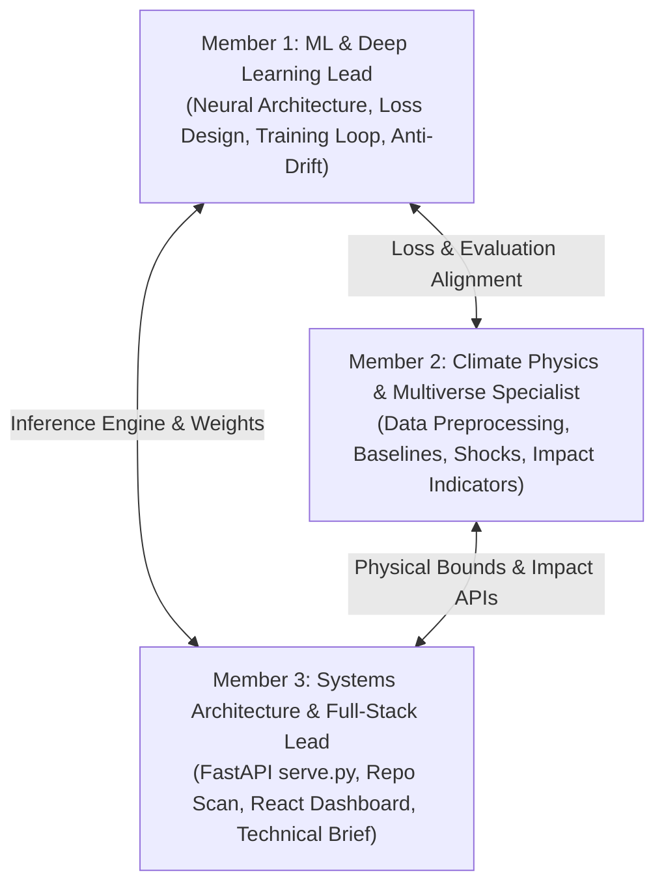

# Multiverse of Monsoon: Team Task Distribution Matrix (3-Member Allocation)
## Track 2: Earth-System Modelling – AI-Powered Climate Digital Twin of India

---

### Executive Overview & Team Topology
To execute Track 2 with maximum engineering rigor while ensuring that every team member deeply understands the architecture and can defend it during the Stage 2 live desk review, responsibilities are partitioned across three specialized engineering roles.

**Core Focus**: Deep Learning weather forecasting, physical climate perturbations, offline serving, and rule-based impact evaluation. **No LLMs, chatbots, or tokenizers are included.**

---

## 1. High-Level Role Profiles

| Member | Primary Title | Core Focus Areas | Primary Key Deliverables |
|---|---|---|---|
| **Member 1** | **ML & Deep Learning Lead** | PyTorch neural architecture (`SpatiotemporalResUNet`), dimensionless multi-objective loss function design, training from scratch on historical ERA5 data, learning rate scheduling, progressive autoregressive unrolling, anti-blur gradient preservation. | `src/models/unet_spatiotemporal.py`, `src/train.py`, `src/loss.py`, `artifacts/model_weights.pt` |
| **Member 2** | **Climate Physics & Multiverse Specialist** | Climate data extraction from NetCDF, z-score normalization, sliding sequence datasets, persistence/climatology baselines, counterfactual perturbation engine, physical causality verification, rule-based heatwave/flood risk algorithms. | `src/dataset.py`, `src/models/baselines.py`, `src/perturbations.py`, `tests/test_perturbations.py`, `src/impact.py` |
| **Member 3** | **Systems Architecture & Full-Stack Lead** | Offline FastAPI serving (`serve.py`), latency and memory optimization, static `repo_scan.py` anti-cheat compliance, React interactive digital twin dashboard, two-page technical brief compilation. | `serve.py`, `frontend/`, `tests/test_repo_integrity.py`, `docs/PROJECT_BRIEF.pdf` |

---

## 2. All-Hands Integration Testing & Review Milestones (All 3 Members)

To avoid single-member integration bottlenecks, all three members jointly participate in 5 formal **Integration Milestones**:

| Milestone | Phase | Scope of Joint Review & Testing | Verification Command | Success Gate Condition |
|---|---|---|---|---|
| **M1: Baseline Lock** | End of Phase 3 | All 3 members cross-verify persistence and climatology baseline benchmarks on validation set. | `python scripts/benchmark_baselines.py` | Exact Day-1, Day-4, and Day-8 persistence RMSE locked as targets. |
| **M2: Training Gate** | End of Phase 5 | All 3 members inspect training loss convergence, verify that Day-4 RMSE beats persistence, and inspect model weight size ($< 2.0\text{ GB}$, target $< 50\text{ MB}$). | `python src/evaluate.py --weights artifacts/model_weights.pt` | Day-4 validation RMSE strictly lower than persistence. |
| **M3: Causality Audit** | End of Phase 6 | All 3 members inspect the 3 official perturbation causality checks and null-shock tolerance ($< 10^{-3}\sigma$). | `python -m unittest tests/test_perturbations.py` | Full 15/15 causality points earned on automated checks. |
| **M4: Serving & Repo Scan** | End of Phase 7 | All 3 members run the official schema validator on `serve.py` and static repository scanner. | `python -m monsoon_r1.schema_validator http://localhost:8000` `python -c "from monsoon_r1.repo_scan import scan; print(scan('.'))"` | Schema validator reports `RESULT: all checks passed`; `repo_scan` scores 15.0/15.0. |
| **M5: Desk-Review Rehearsal** | End of Phase 8 | All 3 members execute end-to-end rehearsal: running shocks on dashboard, verifying impact heatmaps, and auditing two-page brief PDF. | Manual review of dashboard + PDF build | Technical Brief finalized; live demonstration smooth at 60 FPS. |

---

## 3. Granular Task Allocation Matrix

> [!NOTE]
> All tasks below represent the agreed-upon development plan. No implementation tasks have been started yet; execution begins in Phase 1 upon user approval.

### Phase 1: Environment Setup, Dependency Lockdown & Repo Audit
| Task ID | Task Description | Owner | Reviewer | Testing & Verification Method | Concrete Deliverable |
|---|---|---|---|---|---|
| **T1.1** | Setup Python 3.13 venv, configure `requirements.txt` with PyTorch CPU, FastAPI, uvicorn, xarray, netCDF4. | **Member 3** | Member 1 | Run `python -c "import torch, fastapi, xarray; print('OK')"` | `requirements.txt`, clean `.venv` |
| **T1.2** | Verify local `monsoon_r1` package, test `contract.py` constants and wire encoders. | **Member 2** | Member 3 | Run `python -c "from monsoon_r1.contract import CHANNELS, LAT, LON; print(len(CHANNELS))"` | `tests/test_env.py` |
| **T1.3** | Run initial repository scan using `monsoon_r1.repo_scan.scan('.')` to establish code health baseline. | **Member 3** | Member 2 | Run `python -c "from monsoon_r1.repo_scan import scan; print(scan('.'))"` | Baseline scan report in PR notes |

---

### Phase 2: Data Extraction, Dataset Pipeline & Normalization
| Task ID | Task Description | Owner | Reviewer | Testing & Verification Method | Concrete Deliverable |
|---|---|---|---|---|---|
| **T2.1** | Ingest `india_climate_train.nc` via xarray; extract 6 dynamic channels into local cache outside Git index (no multi-year arrays in repo). | **Member 2** | Member 1 | Assert shape is `(6209, 6, 32, 36)`, check date continuum 2005–2021. Confirm no `data_train.npy` in repo root. | `scripts/extract_data.py`, local cache |
| **T2.2** | Extract static features (`land_sea_mask`, `orography_m`) and save to `artifacts/static_features.npy`. | **Member 2** | Member 3 | Assert shape is `(2, 32, 36)`, verify values in range $[0, 1]$ and elevation in $[0, 8848\text{ m}]$. | `artifacts/static_features.npy` |
| **T2.3** | Compute 366-day smoothed climatology array using `monsoon_r1.stats.climatology` and save to `artifacts/climatology.npy`. | **Member 2** | Member 1 | Assert shape is `(366, 6, 32, 36)`, verify leap-year mapping (day 59=Feb 29) and circular smoothing. | `artifacts/climatology.npy` |
| **T2.4** | Build PyTorch `ClimateSequenceDataset` in `src/dataset.py`: 3-day input window, DOY sincos embedding, static channel concatenation. | **Member 1** | Member 2 | Run `python -m unittest tests/test_dataset.py` verifying tensor shapes `(B, 22, 32, 36)`. | `src/dataset.py`, `tests/test_dataset.py` |
| **T2.5** | Implement chronological train (2005–2018), validation (2019–2020), and test (2021) splits ensuring zero future leakage. | **Member 1** | Member 2 | Verify date ranges and split boundaries. | Split logic in `src/dataset.py` |

---

### Phase 3: Baseline Forecasting Engines & Evaluation Benchmarks
| Task ID | Task Description | Owner | Reviewer | Testing & Verification Method | Concrete Deliverable |
|---|---|---|---|---|---|
| **T3.1** | Implement `PersistenceModel` (repeats Day $t$ state across all 10 forward steps). | **Member 2** | Member 1 | Check output shape `(10, 6, 32, 36)` on sample input. | `src/models/baselines.py` |
| **T3.2** | Implement `ClimatologyModel` (looks up smoothed calendar DOY from `climatology.npy`). | **Member 2** | Member 1 | Check output shape `(10, 6, 32, 36)` with advancing DOY. | `src/models/baselines.py` |
| **T3.3** | Build evaluation harness calling `monsoon_r1.scoring.skill_vs_best_ref` and `csi` over validation set (2019–2020). | **Member 2** | Member 3 | Run `python scripts/benchmark_baselines.py` | `scripts/benchmark_baselines.py`, baseline score log |
| **T3.4** | **Milestone M1**: Record exact Day-1, Day-4, and Day-8 RMSE and CSI benchmark scores for persistence and climatology. | **All 3 Members** | All 3 | Review and sign off on baseline benchmark log. | Target criteria for Day-4 gate |

---

### Phase 4: PyTorch Neural Network Architecture & Multi-Objective Loss Design
| Task ID | Task Description | Owner | Reviewer | Testing & Verification Method | Concrete Deliverable |
|---|---|---|---|---|---|
| **T4.1** | Design and implement `SpatiotemporalResUNet` with GroupNorm, residual blocks, and dilated bottleneck in PyTorch. | **Member 1** | Member 3 | Check model parameter count ($< 2\text{M}$) and forward pass latency on CPU ($< 15\text{ ms}$). | `src/models/unet_spatiotemporal.py` |
| **T4.2** | Implement residual tendency prediction head: $\mathbf{X}(t+1) = \mathbf{X}(t) + \mathcal{F}_\theta(\dots)$ ensuring physical continuity. | **Member 1** | Member 2 | Assert output shape matches `(B, 6, 32, 36)` in normalized space. | `src/models/unet_spatiotemporal.py` |
| **T4.3** | Implement primary dimensionless Latitude-weighted RMSE loss and candidate auxiliary terms (MAE, Extreme Rain CSI penalty, Sobolev gradient loss). | **Member 1** | Member 2 | Test loss backward pass on synthetic batch with zero NaN gradients. | `src/loss.py` |
| **T4.4** | Write model unit test suite in `tests/test_models.py` verifying tensor shapes, memory consumption, and gradient flow. | **Member 3** | Member 1 | Run `python -m unittest tests/test_models.py` | `tests/test_models.py` |

---

### Phase 5: Model Training from Scratch, Optimization & Validation
| Task ID | Task Description | Owner | Reviewer | Testing & Verification Method | Concrete Deliverable |
|---|---|---|---|---|---|
| **T5.1** | Build end-to-end training script `src/train.py` with AdamW, CosineAnnealingLR, early stopping, and metric logging. | **Member 1** | Member 2 | Run 1-batch overfit sanity test (verify training loss drops toward zero). | `src/train.py` |
| **T5.2** | Execute Phase A single-step training ($t \to t+1$) for initial experimental epoch budget (e.g. 15 epochs) on 2005–2018 data. | **Member 1** | Member 2 | Plot and track training and validation loss curves. | Training log checkpoint A |
| **T5.3** | Execute Phase B unrolled autoregressive curriculum training (2-to-4 steps) to eliminate forecast drift. | **Member 1** | Member 3 | Verify validation loss stability across unrolled steps. | Training log checkpoint B |
| **T5.4** | **Milestone M2**: Validate trained model against validation set (2019–2020); confirm Day-4 RMSE strictly outperforms persistence. | **All 3 Members** | All 3 | Run `python src/evaluate.py --weights artifacts/model_weights.pt` | Validation benchmark report |
| **T5.5** | Save and package best model weights into `artifacts/model_weights.pt` ($< 2.0\text{ GB}$, target $< 50\text{ MB}$). | **Member 1** | Member 3 | Verify file size is $< 50\text{ MB}$ and loads cleanly on CPU. | `artifacts/model_weights.pt` |

---

### Phase 6: Autoregressive Rollout & Counterfactual Causality Engine
| Task ID | Task Description | Owner | Reviewer | Testing & Verification Method | Concrete Deliverable |
|---|---|---|---|---|---|
| **T6.1** | Implement `AutoregressiveForecaster` in `src/inference.py`: sliding context buffer in normalized space, advancing DOY, denormalization, physical bounds clamping. | **Member 2** | Member 1 | Verify 10-step rollout shape `(10, 6, 32, 36)`, $\text{tp} \ge 0$, and temperature within $[-40^\circ\text{C}, +60^\circ\text{C}]$. | `src/inference.py` |
| **T6.2** | Implement perturbation injector for the 3 official shocks: Warm Bay of Bengal, Arabian Sea Stall, and Null shock. | **Member 2** | Member 3 | Verify exact perturbation masks against `monsoon_r1.contract` definitions. | `src/perturbations.py` |
| **T6.3** | Implement additional presentation scenario: $+2.5^\circ\text{C}$ Arabian Sea Heat Anomaly on air temperature (`t2m`). | **Member 2** | Member 3 | Verify shock localization and realistic downwind propagation. | `src/perturbations.py` |
| **T6.4** | **Milestone M3**: Build causality test suite in `tests/test_perturbations.py` running `monsoon_r1.scoring.causality_checks`. | **All 3 Members** | All 3 | Confirm all 4 causality checks pass (finite, nonzero, localized, propagates, stable) with full 15/15 points. | `tests/test_perturbations.py` |

---

### Phase 7: Production Offline Serving API (`serve.py`) & Official Validation
| Task ID | Task Description | Owner | Reviewer | Testing & Verification Method | Concrete Deliverable |
|---|---|---|---|---|---|
| **T7.1** | Create production `serve.py` at repository root using FastAPI and uvicorn listening on `0.0.0.0:8000`. | **Member 3** | Member 1 | Test server launch: `python serve.py --port 8000`. | Root `serve.py` |
| **T7.2** | Implement model pre-warming in FastAPI startup/lifespan: pre-load weights, run 1 dummy simulation, confirm `/health` ready. | **Member 3** | Member 2 | `curl http://localhost:8000/health` returns `{"status": "ready"}`. | Lifespan handler in `serve.py` |
| **T7.3** | Connect `/simulate` endpoint to `src/inference.py`; handle nested JSON lists, run rollout, return elapsed `inference_ms`. | **Member 3** | Member 1 | Measure single 10-step request latency on CPU (official limit 5.0 s, target $< 500\text{ ms}$). | `/simulate` handler in `serve.py` |
| **T7.4** | **Milestone M4a**: Execute official schema validator: `python -m monsoon_r1.schema_validator http://localhost:8000`. | **All 3 Members** | All 3 | Output must read `RESULT: all checks passed`. | Schema validator audit log |
| **T7.5** | **Milestone M4b**: Execute official static scanner: `python -c "from monsoon_r1.repo_scan import scan; import json; print(json.dumps(scan('.'), indent=1))"`. | **All 3 Members** | All 3 | Confirm anti-cheat is 8.0/8.0, code health is 7.0/7.0, total 15.0/15.0 points. | `tests/test_repo_integrity.py` |

---

### Phase 8: Real-World Impact Engine, React Dashboard & Technical Brief
| Task ID | Task Description | Owner | Reviewer | Testing & Verification Method | Concrete Deliverable |
|---|---|---|---|---|---|
| **T8.1** | Implement `src/impact.py`: rule-based calculation of IMD Heatwave departure index, Flash Flood Index, and High Wind Hazard from `/simulate` outputs (no LLM, no tcwv-derived surface RH). | **Member 2** | Member 3 | Verify calculation runs live from tensor rollout; zero hardcoded maps; no LLMs. | `src/impact.py` |
| **T8.2** | Initialize React + Vite dashboard in `frontend/` with Tailwind CSS; build map canvas rendering $32 \times 36$ weather grid over India. | **Member 3** | Member 2 | Verify map renders heatmaps smoothly at 60 FPS. | `frontend/src/components/ClimateMap.jsx` |
| **T8.3** | Implement 10-day timeline scrubber and Multiverse Studio panel (Baseline vs Warm BoB vs Arabian Stall vs +2.5°C Heat Anomaly). | **Member 3** | Member 2 | Verify scenario toggle triggers live `/simulate` calls and renders difference map. | `frontend/src/components/ScenarioPanel.jsx` |
| **T8.4** | Build interactive Impact Layer toggles in dashboard: Heatwave Warning Map and Flash Flood Hazard Map. | **Member 3** | Member 2 | Verify impact layers reflect live model predictions. | `frontend/src/components/ImpactLayer.jsx` |
| **T8.5** | Author Page 1 of Technical Brief: Neural network design, curriculum training, Sobolev anti-blur loss, failure modes and limitations. | **Member 1** | Member 3 | Compile PDF and review against page limits. | Draft Page 1 |
| **T8.6** | Author Page 2 of Technical Brief: Dashboard visualization, Multiverse counterfactual analysis, Heatwave/Flood impact methodology. | **Member 2** | Member 3 | Compile PDF and review against page limits. | Draft Page 2 |
| **T8.7** | **Milestone M5**: Assemble and audit final two-page PDF: `docs/PROJECT_BRIEF.pdf`. | **All 3 Members** | All 3 | Verify PDF rendering, formatting, and content density. | `docs/PROJECT_BRIEF.pdf` |

---

## 4. Team Communication, Git Protocols & Safety Rules

1. **Feature Branching**:
   - All development takes place on dedicated branch `feature/track2-multiverse-monsoon`.
   - Never commit directly to `main`.
2. **Review & Merge Protocol**:
   - Every pull request must be reviewed by the assigned reviewer before merging.
   - PRs must pass `tests/test_repo_integrity.py` and `tests/test_models.py` before approval.
3. **Strict Prohibition on Large Datasets in Git**:
   - Never commit `*.nc`, `*.zarr`, or multi-year daily arrays (`shape (n > 400, ..., 32, 36)`) to Git.
   - Model weights must remain strictly below $2.0\text{ GB}$ (internal target $\approx 5\text{ MB}$).
4. **Offline Serving Guarantee**:
   - Every file required for inference must reside inside the repository.
   - Zero network requests inside `serve.py` or imported inference modules.
